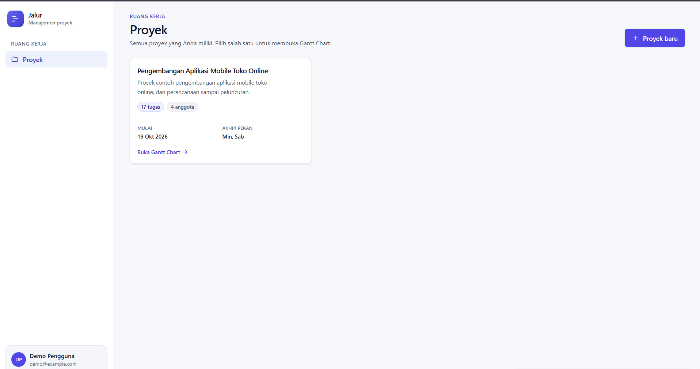
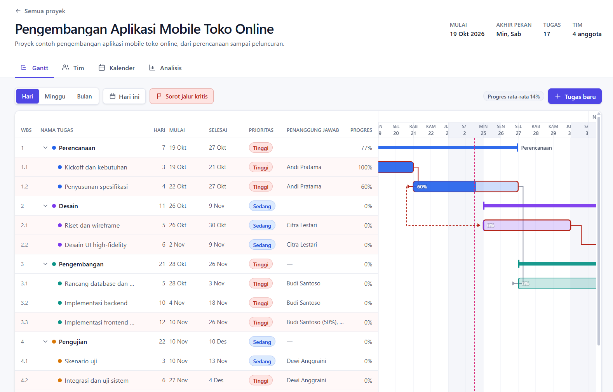

# Gantt Project App

Aplikasi manajemen proyek berbasis Gantt Chart: menyusun tugas berjenjang (WBS), dependensi FS/SS dengan lag, kalender kerja, alokasi tim, serta analisis jalur kritis (CPM), PERT, dan biaya — seluruhnya dihitung ulang otomatis di server setiap ada perubahan.

## Tangkapan layar

**Halaman proyek** — daftar proyek pengguna:



**Gantt Chart** — tabel tugas (WBS, durasi, penanggung jawab, progres) berdampingan dengan timeline, panah dependensi FS/SS, dan sorotan jalur kritis:



## Fitur

- **Gantt Chart**: tabel tugas (WBS, nama, durasi, mulai, selesai, prioritas, penanggung jawab, progres) berdampingan dengan timeline SVG; zoom Hari/Minggu/Bulan, tombol *Hari ini*, garis hari ini, arsiran akhir pekan dan hari libur, bar induk bergaya bracket, dan bar tugas daun yang bisa di-drag serta di-resize.
- **Struktur tugas**: induk–anak maksimal 3 level, roll-up rentang, durasi, dan progres otomatis dari anak.
- **Dependensi**: FS dan SS dengan lag hari kerja; siklus, self-dependency, dan duplikat ditolak dengan pesan jelas.
- **Tim**: anggota (nama, email, peran, gaji), alokasi tugas dalam persen, biaya per anggota, dan peringatan over-alokasi.
- **Kalender**: pengaturan tujuh hari untuk akhir pekan, daftar hari libur, kalender bulanan mini yang menandai hari non-kerja; jadwal bergeser otomatis.
- **Analisis**: ringkasan proyek, jalur kritis, tabel CPM (ES, EF, LS, LF, float, kritis), diagram PERT yang bisa di-scroll dan di-zoom (node dan panah kritis ditandai merah), biaya tenaga kerja, dan beban kerja tim.
- **Akun**: register, login, dan logout; setiap pengguna hanya dapat mengakses proyek miliknya.
- **UX**: label bahasa Indonesia, state loading/kosong/error di setiap halaman, toast untuk hasil aksi, konfirmasi sebelum menghapus, validasi form memakai skema zod dari paket `shared`.

## Tech stack

| Lapisan | Teknologi |
| --- | --- |
| Monorepo | npm workspaces (`shared`, `server`, `client`) |
| Mesin inti | TypeScript murni (tanggal UTC, kalender, scheduler, CPM, PERT, biaya) + zod |
| Backend | Express 4, Prisma 6 + SQLite, JWT, bcryptjs, helmet, cors, express-rate-limit |
| Frontend | React 18, Vite 5, TypeScript, Tailwind CSS 3, TanStack Query, React Router 6, react-hook-form |
| Pengujian | Vitest (shared, client) dan Vitest + Supertest (server) |

## Prasyarat

- Node.js 20+ dan npm
- Tidak perlu database terpisah; SQLite dibuat otomatis oleh Prisma

## Instalasi

```bash
npm install
cp .env.example .env        # Windows: copy .env.example .env
npm run db:migrate
npm run db:seed
```

Isi `JWT_SECRET` di `.env` dengan string acak (wajib; server menolak start bila kosong).

## Menjalankan

```bash
npm run dev
```

- Aplikasi: http://localhost:5173
- API: http://localhost:3001 (cek cepat: http://localhost:3001/api/health)

## Pengujian dan build

```bash
npm run typecheck   # seluruh workspace
npm test            # unit shared, integrasi server, komponen client
npm run build       # shared, server, client
```

## Akun demo

| Email | Kata sandi |
| --- | --- |
| `demo@example.com` | `Demo12345` |

## Ringkasan API

Semua rute berada di bawah `/api`. Rute selain `POST /auth/register`, `POST /auth/login`, dan `GET /health` memerlukan header `Authorization: Bearer <token>`. Data proyek selalu dicek kepemilikannya (selain pemilik memperoleh 404). Format error: `{ "error": { "code": "...", "message": "...", "details": {} } }`.

| Method dan path | Fungsi |
| --- | --- |
| GET `/health` | Cek server hidup |
| POST `/auth/register`, POST `/auth/login`, GET `/auth/me` | Registrasi, masuk, data user |
| GET, POST `/projects` | Daftar dan buat proyek |
| GET, PATCH, DELETE `/projects/:id` | Snapshot lengkap, ubah, hapus |
| POST `/projects/:id/tasks`, PATCH `/tasks/:id`, DELETE `/tasks/:id`, POST `/tasks/:id/move` | CRUD tugas dan perpindahan induk |
| POST `/tasks/:id/dependencies`, PATCH/DELETE `/dependencies/:id` | Predecessor FS/SS dengan lag |
| GET, POST `/projects/:id/resources` | Daftar dan tambah anggota tim |
| PATCH, DELETE `/resources/:id` | Ubah dan hapus anggota |
| POST `/tasks/:id/assignments`, PATCH/DELETE `/assignments/:id` | Alokasi tugas dalam persen |
| PUT `/projects/:id/calendar` | Atur akhir pekan (jadwal dihitung ulang) |
| POST `/projects/:id/holidays`, DELETE `/holidays/:id` | Hari libur |
| GET `/projects/:id/analysis` | CPM, jalur kritis, PERT, biaya, beban resource |

Setiap mutasi yang mengubah jadwal mengembalikan `{ tasks: [...] }` berisi seluruh tugas terbaru.

## Struktur proyek

```
shared/   # mesin penjadwalan, CPM, PERT, biaya, skema zod (sumber kebenaran logika)
server/   # Express + Prisma, rute, middleware, seed, test integrasi
client/   # React + Vite, halaman Gantt/Tim/Kalender/Analisis, test komponen
docs/     # tangkapan layar yang direferensikan README
```

## Asumsi

- Hari kerja mengikuti `weekendDays` proyek dan daftar hari libur; libur akhir pekan dihitung satu kali (bukan ganda).
- Hari kerja dihitung dari hari pertama proyek (ordinal 0); `startDate` tugas bersifat "mulai paling awal", batas dependensi dapat menggeser jadwal ke kanan.
- Biaya memakai tarif harian `gaji / 22` dan hanya dihitung untuk tugas daun yang punya alokasi; total memakai durasi tugas terjadwal (bobot alokasi persen).
- PERT hanya menampilkan estimasi pada tugas yang mengisi `optimisticDays` dan `pessimisticDays`; estimasi tidak mengubah jadwal.
- Token JWT disimpan di localStorage; preferensi tampilan (zoom, sorot jalur kritis) disimpan di state komponen.
- Server dev berjalan pada port 3001 dan client dev pada 5173; proksi Vite meneruskan `/api` ke server.
